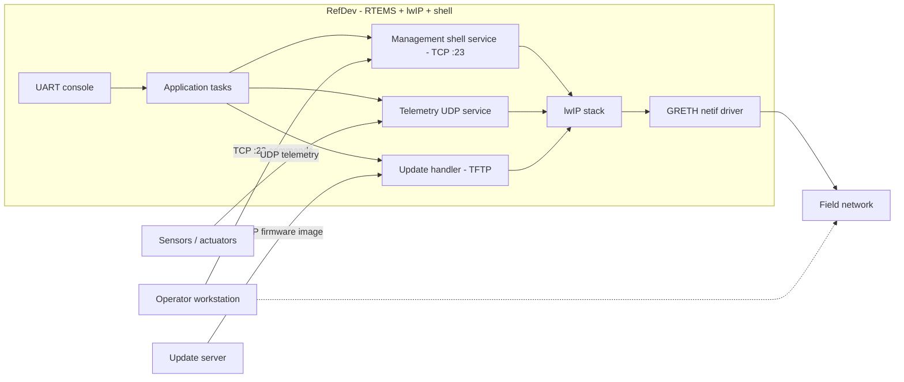

# Reference device (RefDev) definition

A generic RTEMS-based networked device for the CRA review. No client or product names.

| Element | Definition |
|---|---|
| Hardware | SPARC/LEON3 target (built as erc32/leon3), GRETH Ethernet MAC, UART console |
| Firmware | RTEMS 7 (erc32 BSP), rtems-lwip TCP/IP stack, RTEMS shell over serial and Telnet |
| Software composition | Application tasks + RTEMS kernel + lwIP + shell + device "sensor" stubs |
| Interfaces | TCP/UDP networking: management shell over Telnet :23, a status/sensor UDP service; UART debug console; optional TFTP for field updates |
| Data | Sensor readings (telemetry UDP), management commands (TCP), firmware images during update. No stored personal data |
| Failure modes | Command injection over the shell listener, unauthenticated telemetry/config changes, update-image tampering, DoS against the TCP/IP stack |

## Data-flow (drives the STRIDE model)

Threat surfaces: the unauthenticated Telnet shell; the UDP telemetry path
(spoofing/tampering); the TFTP update path (tampering/repudiation); the GRETH driver
boundary (malformed frames -> kernel); the UART console (physical access).
