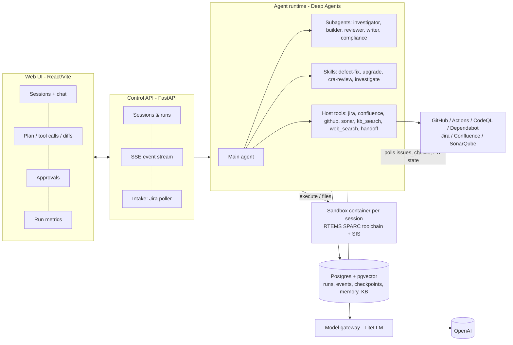

# 02 Architecture

Thin on purpose. Seven boxes, each doing real work in the demo.

## Components

| # | Component | Tech | Does |
|---|---|---|---|
| C1 | Web UI | React + Vite + Tailwind, SSE | Session list; new task (repo, environment, mode, model profile); chat stream with plan (todos), collapsible tool calls, terminal output, diffs; approvals inbox; run record (replay info, cost, tokens, human touches) |
| C2 | Control API | FastAPI, SQLAlchemy, Postgres | Users (one demo user + bearer token), sessions, runs, events (SSE), approvals, intake (Jira poller) |
| C3 | Agent runtime | `deepagents` 0.7.x on LangGraph 1.x | `create_deep_agent` with sandbox backend, subagents, skills, memory, `interrupt_on` for approvals, Postgres checkpointer |
| C4 | Model gateway | LiteLLM proxy (docker) | Aliases (`anvil-main`, `anvil-fast`, `anvil-embed`), per-run spend-log tags (`metadata.spend_logs_metadata.run_id`), budget per run, provider swap without code change |
| C5 | Sandbox manager | Docker SDK for Python | One container per session from `anvil-sandbox-rtems:7`; workspace volume; CPU/memory limits; no credentials inside; destroyed or kept on handoff |
| C6 | Knowledge + memory | Postgres + pgvector | KB index (RTEMS GitLab issues, rtems-docs, Confluence KB space); LangGraph store for `/memories/`; code search stays agentic (ripgrep in the sandbox) |
| C7 | Quality gates | GitHub Actions on the mirrors | Same sandbox image (GHCR) builds the BSP and runs tests on SIS; CodeQL (C/C++, manual build); SonarQube; cppcheck; Syft SBOM + OSV-Scanner; Dependabot where an ecosystem exists |

## The closed loop (TC1 path)

1. **Intake.** A Jira issue in project `RTEMS` gets label `anvil` (= ready for agent; labels carry
   agent state because the projects use the default workflow). The poller (every 60 s) creates a
   run in mode *autonomous* and moves the issue to *In Progress*.
2. **Branch.** Sandbox starts; repo cloned at the issue's base ref into `/workspace/<repo>`;
   branch `anvil/<issue-key-lower>-<slug>`.
3. **Work.** Main agent loads the `defect-fix` skill, writes a plan (todos), delegates code
   archaeology to `investigator`, reproduces with a failing test, fixes, builds the BSP, runs
   the targeted tests and the regression subset on SIS via `builder`.
4. **Pre-commit.** `pre-commit run` in the sandbox (clang-format on changed lines, trailing
   whitespace, cppcheck on changed files, commit-message check `<KEY>: ...`). Failures go back to
   the agent like any test failure.
5. **Self-review.** `reviewer` reads the diff against the skill's checklist (coding style,
   MISRA-ish hazards, test present, docs touched).
6. **Commit and push.** The agent commits in the sandbox (author `anvil-bot`, trailer
   `Anvil-Run: <run_id>`). Host tool `git_push` exports the commits with `git bundle`, applies them
   to the host clone and pushes. The sandbox never holds tokens.
7. **PR.** Host tool `github_open_pr` opens the PR (title `<KEY>: ...`, body = root cause, change,
   tests, evidence links, run record link) and links it in Jira.
8. **CI.** Actions build + test + CodeQL + Sonar on the PR. Agent waits on `github_checks`,
   reads failures, code-scanning alerts and Sonar issues, pushes fixes (max 3 CI rounds).
9. **Evidence.** `writer` posts a Jira comment (root cause, fix, tests, CI links, cost) and a
   Confluence evidence page in RTKB; label `anvil-in-review`.
10. **Merge (policy).** `github_merge` is allowed only when CI is green, the `reviewer` subagent
    approved, and the run's merge policy allows it: `human` (default for the demo of TC1: a person
    merges), `agent-after-approval` (agent merges after a human clicks Approve in the UI or on the
    PR), or `agent` (fully autonomous, for low-risk classes like docs). On merge: Jira *Done*, one
    lesson written to `/memories/rtems/lessons.md`.

### Stuck detection and handoff (demonstrable)

The runtime, not the model, decides the agent is stuck when any of these hold:
step budget hit, cost budget hit, same command failing 3 times with the same error signature,
no change to the diff in the last N tool calls, CI red after 3 rounds. Then it forces the
`handoff` path: commit WIP to `anvil/<key>-wip`, write a handoff note (goal, what was tried,
evidence, current hypothesis, suggested next step) to Jira, label the issue `anvil-needs-human`, and
keep the sandbox for 24 h so the engineer can attach to it. The model can also call `handoff`
itself.

### Safety rails

* Credentials live in the API process only; sandbox containers get none and run as non-root.
* `interrupt_on` gates: `git_push`, `github_open_pr`, `github_merge`, `jira_transition`,
  `confluence_write`. Policy per run mode: *interactive* asks for each; *autonomous* auto-approves
  push, PR and comments. Merge follows the run's merge policy (step 10); the default is human.
* The agent never changes `.github/`: `git_push` refuses, on the host clone, any push whose new
  commits touch it, and `github_merge` refuses PRs that do. These are the only guards: GitHub auth
  is the owner's `gh` login, which has `workflow` scope. (Harness path permissions don't apply to
  sandboxes with a shell, which could bypass them.)
* Subagents get no host tools (`"tools": []`): the approval gate lives on the main agent only, so
  inherited outward tools would bypass it.
* Budgets per run (tokens, USD, wall time) enforced in the runtime and in the gateway.

## Environments ("where does the agent run")

The UI offers an environment picker like Claude Code's:

| Environment | Meaning | Milestone |
|---|---|---|
| Local sandbox | Docker container on this laptop | M1 |
| Cloud (GitHub Actions) | Same image on an Actions runner; the run is dispatched with `workflow_dispatch`, events posted back to the API | Stretch (M4) |

## Contracts (so workstreams can build in parallel)

### Event stream (API -> UI, SSE `GET /api/runs/{id}/events`)

Every event: `{"run_id", "seq", "ts", "type", "agent", "data"}`. Types:

| type | data |
|---|---|
| `run.status` | `{status: queued|running|waiting_approval|handoff|succeeded|failed|cancelled}` (`cancelled` = stopped by a human via `POST /api/runs/{id}/cancel`; terminal, distinct from `failed`) |
| `message.delta` / `message` | `{role, text}` |
| `plan` | `{todos: [{content, status}]}` |
| `tool.call` | `{call_id, name, args}` |
| `tool.result` | `{call_id, ok, output (truncated), duration_ms}` |
| `sandbox.exec` | `{cmd, exit_code, output_tail}` |
| `diff` | `{files: [{path, patch}]}` |
| `approval.request` | `{approval_id, action, args, reason}` |
| `subagent` | `{name, phase: start|end, summary}` |
| `usage` | `{model_alias, input_tokens, output_tokens}` (USD comes from the gateway spend log per run, ANVIL-25) |
| `artifact` | `{kind: pr|jira_comment|confluence_page|sbom|report|handoff, url, title}` |
| `run.record` | reproducibility fields: base_ref/base_sha, branch, network, sandbox image + digest, model aliases, prompt_hash, skills + skills_hash, mode, merge_policy, trigger |

### REST

`POST /api/sessions` {repo, environment, mode, model_profile, title?} ->
`POST /api/sessions/{id}/messages` {text, scenario?} (starts a run; an optional scenario is stored in `run_record.scenario`) ->
`GET /api/runs/{id}/events` (SSE) · `POST /api/approvals/{id}` {decision, comment} ·
`GET /api/runs/{id}` (run record and metrics) · `GET /api/metrics?from&to&scenario` ·
`POST /api/runs/{id}/cancel` · `POST /api/intake/jira/poll`
(manual trigger). No webhooks: a laptop has no public URL, so PR and check state are polled.

Metrics time bounds are timezone-aware timestamps over run creation time. A scenario filter
matches `run_record.scenario` exactly. Cost and model-call counts come from LiteLLM spend logs
tagged with `metadata.spend_logs_metadata.run_id`. Chat Completions requests send that custom
tag under `metadata`; the Responses API uses `litellm_metadata`. Token counts and human/CI
activity come from the API event log. If token usage exists before its spend row is available,
the metrics endpoints return `503` with `Retry-After` while spend data is pending (up to five
minutes after the latest usage event). After that grace period, they return `cost_usd: null`
and `cost_status: "missing"` rather than reporting false zero cost. `GET /api/metrics` sums cost
over the runs that have spend rows and reports the rest as `runs_missing_cost`; its `cost_status`
is `available`, `partial`, or `missing` (no run in the range priced).

### Run record (reproducibility)

`run_id, session_id, trigger (ui|jira:<key>), repo, base_sha, branch, sandbox_image_digest,
model_aliases + resolved model ids, skill versions (git sha of skills/), prompt hash,
budgets, started/ended, status, usd, tokens, human_touches, artifacts[]`.
LangGraph checkpoints give step-level replay and rewind; the git branch gives code rollback.

## Tech pins

Python 3.12, `uv`; `deepagents` 0.7.x, `langgraph` 1.2.x, `langgraph-checkpoint-postgres` 3.x,
FastAPI, `docker` SDK, `litellm` proxy image; Node 24, React 19, Vite; Postgres 17 + pgvector.
