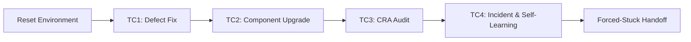

# Anvil Live Demonstration Runbook

**Document Version:** 1.0  
**Target Milestone:** M4 (Demo Ready)  
**Applicable Scenarios:** TC1 (Defect Fix), TC2 (Component Upgrade), TC3 (CRA Review), TC4 (Incident Investigation & Self-Learning), Forced-Stuck Handoff.  
**Audience:** Demonstration presenters, evaluators, and system operators.

---

## 1. System Setup & Pre-Flight Checklist

### 1.1 Local Stack Verification
Before inviting evaluators or beginning recorded rehearsals, verify the host stack:

1. **Containers & Services:**
   ```powershell
   # Start background stack (Postgres on 5433, Model Gateway on 4000)
   .\scripts\up.ps1
   ```
2. **Web UI & Backend API:**
   - Backend API: `http://localhost:8000/api/runs`
   - Frontend Web UI: `http://localhost:5173`
   - Model Gateway: `http://localhost:4000/health`
3. **Sandbox Image Available:**
   ```powershell
   docker image inspect anvil-sandbox-rtems:7 > $null
   if ($LASTEXITCODE -ne 0) {
       docker pull ghcr.io/vishal7pandey/anvil-sandbox-rtems:7
       docker tag ghcr.io/vishal7pandey/anvil-sandbox-rtems:7 anvil-sandbox-rtems:7
   }
   ```
4. **Environment Reset (The Clean Slate):**
   Always run the demo reset before starting a demo run:
   ```powershell
   .\scripts\reset-demo.ps1
   ```
   *Verifies:*
   - `RTEMS-1` through `RTEMS-6` tickets in Jira reset to `To Do` with baseline labels.
   - Remote mirror branches (`anvil/*`) and unmerged PRs cleared.
   - Confluence `RTKB` purged of agent-written pages (preserving the 10 synthetic baseline pages).
   - Vector database re-ingested.
   - Ephemeral `anvil-sbx-*` containers terminated.

---

## 2. Minute-by-Minute Scenario Execution



---

### Scenario 1: TC1 Autonomous Defect Diagnosis & Patch (RTEMS-1)
*Demonstrates: Autonomous root-cause reasoning, isolated test generation, and verified patch application with the reference fix withheld.*

- **Target Ticket:** `RTEMS-1` (`Mutex reports EBUSY / crashes after a failed pthread_mutex_init with an invalid priority ceiling`).
- **Codebase:** `vishal7pandey/rtems` on branch `tc1/5776-base`.
- **Target Architecture:** SPARC / ERC32 (`sparc/erc32`) via SIS simulator.
- **Estimated Duration:** ~5–7 minutes.

#### Minute-by-Minute Timeline
| Elapsed | Action / Agent State | Evaluator Talk Track |
|---|---|---|
| **0:00 - 0:30** | Add label `anvil` to Jira issue `RTEMS-1`. Anvil intake poller discovers ticket and creates run. | *"We trigger Anvil simply by labelling the Jira ticket `anvil`. The autonomous intake poller launches an isolated Docker sandbox with RTEMS 7 tools."* |
| **0:30 - 2:00** | Agent checks out `tc1/5776-base`, reviews the defect description, locates `score/src/threadqops.c` and POSIX mutex init, and compiles a targeted reproduction test. | *"Notice that the upstream solution from late 2026 is withheld. The agent inspects the RTEMS source tree, notes that `_POSIX_Mutex_Initialize` sets flags before validating ceilings, and reproduces the failure under the SIS simulator."* |
| **2:00 - 4:00** | Agent edits `cpukit/posix/src/mutexinit.c`, applies the ordering fix, builds `sparc/erc32`, and executes `psx05.exe` and `psxtests` on SIS. | *"The agent applies the fix and immediately verifies that `psx05.exe` passes, then runs the full POSIX test subset on SIS (87/87 pass) to ensure zero regressions."* |
| **4:00 - 5:30** | Agent pushes branch `anvil/rtems-1-mutex-fix`, opens a GitHub Pull Request, and waits for CI check completion. | *"The agent pushes a clean Git commit formatted to project standards and opens a PR on GitHub. Notice the live SSE event stream streaming progress directly to our dashboard."* |
| **5:30 - 6:30** | **Human Gate: PR Review & Approval.** Human reviewer approves PR. Agent detects merge or approval, posts run metrics, and marks `RTEMS-1` **Done**. | *"Anvil never merges to production without human consent. As the lead engineer, I review the diff in GitHub, approve the PR, and Anvil closes the Jira loop."* |

---

### Scenario 2: TC2 Open-Source Component Upgrade (RTEMS-2)
*Demonstrates: Autonomous dependency management, C port layer adaptation, cross-compilation, and compliance artifact generation (SBOM, OSV CVE analysis & follow-ups, API impact).*

- **Target Ticket:** `RTEMS-2` (`Upgrade vendored lwIP to 2.2.1 in rtems-lwip`).
- **Codebase:** `vishal7pandey/rtems-lwip` on branch `tc2/upgrade-base-leon3`.
- **Target Architecture:** SPARC / LEON3 (`sparc/leon3`) via SIS simulator.
- **Estimated Duration:** ~6–8 minutes.

#### Minute-by-Minute Timeline
| Elapsed | Action / Agent State | Evaluator Talk Track |
|---|---|---|
| **0:00 - 1:00** | Label `anvil` added to `RTEMS-2`. Agent checks baseline (`lwIP 2.1.3`), fetches upstream tag `STABLE-2_2_1_RELEASE`, and drafts upgrade plan. | *"In TC2, Anvil acts as a dependency maintenance engineer. It compares vendored sources against the upstream lwIP release tag to identify added files and changed signatures."* |
| **1:00 - 3:00** | Agent advances submodule, updates in-tree `lwip/` tree according to `file-import.json`, imports newly mandatory Address Conflict Detection (`acd.c`), and adjusts `lwipopts.h`. | *"Notice how the agent updates the Waf build files and handles API shifts like Address Conflict Detection without human guidance."* |
| **3:00 - 5:30** | Agent configures Waf (`--prefix=/opt/rtems/7 --rtems-tools=/opt/rtems/7 --rtems-bsps=sparc/leon3`) and compiles `networking01.exe` in ~2 minutes. Runs SIS simulation (0.28s). | *"The stack is cross-compiled for SPARC/LEON3 using RTEMS Waf. The agent executes `networking01.exe` on SIS—zero host network tap or root permissions required."* |
| **5:30 - 7:00** | Agent generates Syft SBOM delta (SPDX), OSV-Scanner CVE analysis report, API impact summary, and publishes release documentation to Confluence space `RTKB`. | *"Beyond code, Anvil generates complete compliance artifacts: before/after SBOMs, API impact notes, and OSV vulnerability analysis. Notice that OSV records lwIP 2.1.3 (commit 6ca936f) with 0 known vulns and 2.2.1 (commit 77dcd25) with 3 (CVE-2026-112062, CVE-2026-119053, CVE-2026-8836). Rather than falsely claiming CVEs were remediated, Anvil flags the 3 newly surfaced CVEs in the target version and drafts follow-up tickets."* |
| **7:00 - 8:00** | **Human Gate: Upgrade Approval.** Reviewer inspects SBOM, CVE flags, and PR. Ticket transitioned to **Done**. | *"We inspect the SBOM diff and the CVE report flagging the 3 new target-version CVEs for follow-up, verify simulator test passage, and approve the upgrade PR."* |

---

### Scenario 3: TC3 Cyber Resilience Act (CRA) Compliance Audit (RTEMS-3)
*Demonstrates: Regulatory compliance assessment, machine-readable checklist validation, gap analysis, STRIDE threat modeling, and human-in-the-loop SME feedback.*

- **Target Ticket:** `RTEMS-3` (`[TC3] CRA Annex I compliance review of reference RTEMS networked device`).
- **Target Device:** RefDev (RTEMS 7 + lwIP networking + shell on LEON3).
- **Estimated Duration:** ~4–5 minutes.

#### Minute-by-Minute Timeline
| Elapsed | Action / Agent State | Evaluator Talk Track |
|---|---|---|
| **0:00 - 1:00** | Label `anvil` added. Agent loads authoritative `annex1.yaml` checklist (EU 2024/2847 Annex I) and queries codebase, SBOMs, and scan reports. | *"With the EU Cyber Resilience Act in effect, embedded systems require systematic verification. Anvil executes a compliance audit based on an authoritative Annex I checklist."* |
| **1:00 - 2:30** | Agent evaluates security requirements: access control, telemetry encryption, memory protection, vulnerability handling. Identifies 2 actionable gaps. | *"The agent identifies specific gaps—such as unauthenticated debug shell interfaces—and automatically files Jira remediation stories with full traceability."* |
| **2:30 - 3:30** | Agent constructs a STRIDE threat model from the device architecture, builds CycloneDX SBOM, and publishes compliance audit page in Confluence `RTKB`. | *"Here is the generated STRIDE threat model and the audit report published directly into the engineering knowledge base."* |
| **3:30 - 4:30** | **Human Gate: Security Engineer Review.** Security engineer reviews findings. Evaluator rejects 1 proposed gap; rejection reasons are recorded into `/memories/cra/lessons.md`. | *"Watch the feedback loop: When our security engineer rejects a finding as an acceptable operational risk, Anvil records the decision into persistent memory so it doesn't repeat the recommendation."* |

---

### Scenario 4: TC4 Knowledge Base Incident Triage & Self-Learning (RTEMS-5 & RTEMS-6)
*Demonstrates: Multimodal knowledge retrieval from Confluence, look-alike incident discrimination, root-cause diagnosis, simulator reproduction, and self-learning retrieval.*

- **Target Tickets:**
  - **Run 1:** `RTEMS-5` (`Incident: Telemetry packet drops and TM_GUIDANCE deadline overrun under burst traffic`).
  - **Run 2 (Self-Learning):** `RTEMS-6` (`Secondary payload instrument reports intermittent telemetry packet drops during burst mode`).
- **Knowledge Store:** PostgreSQL `anvil` (pgvector chunks of Confluence `RTKB` + seeded runbooks).
- **Estimated Duration:** ~8–10 minutes total (Run 1: ~5m, Run 2: ~3m).

#### Minute-by-Minute Timeline
| Elapsed | Action / Agent State | Evaluator Talk Track |
|---|---|---|
| **0:00 - 2:00** | **Run 1 Start:** Label `anvil` on `RTEMS-5`. Agent queries KB using hybrid dense-sparse search via `kb_search`. | *"During sensor bursts, high-priority telemetry is dropped. Anvil queries our engineering wiki space `RTKB` to investigate past operational runbooks."* |
| **2:00 - 3:30** | **Look-alike Discrimination:** Agent inspects 3 candidate incidents (2024 PDU Relay Chatter vs 2026 X-band Transponder vs 2025 Payload Guidance Overrun). Accurately discards false leads and pinpoints telemetry queue buffer exhaustion (`RTEMS_TOO_MANY`). | *"Notice how Anvil discriminates between look-alike incidents: it rules out power transients and RF anomalies, correctly identifying telemetry message queue depth constraints."* |
| **3:30 - 5:00** | Agent publishes Incident Post-Mortem page to Confluence `RTKB` with verified sizing remediation, reproduces queue saturation on SIS, and requests SME confirmation. | *"Anvil documents the incident post-mortem into `RTKB` and indexes it into the vector store. This institutional knowledge is now active."* |
| **5:00 - 5:30** | **Transition to Run 2 (Self-Learning):** Presenter resets environment with `.\scripts\reset-demo.ps1 -Confluence -KeepTc4Run1`, preserving Run 1's incident analysis page. | *"Now we demonstrate self-learning. We preserve the newly created post-mortem and simulate a secondary instrument team encountering a similar symptom."* |
| **5:30 - 7:30** | **Run 2 Start:** Label `anvil` on `RTEMS-6`. Agent investigates secondary instrument packet drop. | *"When investigating RTEMS-6, watch what Anvil retrieves first: it retrieves the exact post-mortem written in Run 1 just minutes ago, citing previous findings and recommending immediate resolution."* |

---

### Scenario 5: Forced-Stuck & Graceful Human Handoff (RTEMS-4)
*Demonstrates: Safety bounds, dead-end detection, and graceful human handoff without infinite loops or hallucinated fixes.*

- **Target Ticket:** `RTEMS-4` (`[TC-forced-stuck] Tune GRETH RX/TX descriptor ring timing on real LEON3 hardware`).
- **Nature of Defect:** Hardware-only race condition that cannot be modeled in SIS simulation.
- **Estimated Duration:** ~3–4 minutes.

#### Minute-by-Minute Timeline
| Elapsed | Action / Agent State | Evaluator Talk Track |
|---|---|---|
| **0:00 - 1:30** | Label `anvil` added to `RTEMS-4`. Agent inspects driver code and attempts simulator reproduction. | *"In mission-critical engineering, knowing when to stop is as important as knowing how to patch. RTEMS-4 requires physical logic analyzer traces on LEON3 hardware that cannot be observed in SIS."* |
| **1:30 - 3:00** | Agent recognizes that the required DMA descriptor timing cannot be verified on the simulator after repeated bounded attempts. It triggers `handoff`. | *"Anvil's stuck-detection algorithm prevents infinite retry loops or hallucinated solutions. Recognizing the hardware barrier, the agent executes `handoff`."* |
| **3:00 - 4:00** | Agent commits current progress to WIP branch `anvil/rtems-4-wip`, posts structured handoff note with hypotheses and next steps, and adds Jira label `anvil-needs-human`. | *"The agent cleanly escalates to a human engineer: it saves its WIP branch, leaves a diagnostic summary explaining what was tried and what hardware tools are needed next, and flags the ticket `anvil-needs-human`."* |

---

## 3. Human Gate Cheat Sheet (What to Say & Do)

| Gate | Scenario | Agent Prompt / State | Operator Action | Speaking Points |
|---|---|---|---|---|
| **Gate 1: Code Diff Review** | TC1 | Agent opens PR #X, requests review | Open GitHub PR link in browser, inspect `mutexinit.c` diff, click **Approve** and **Squash and Merge**. | *"We verify that the mutex initialization flags are written only after parameter validation. Clean diff, zero warnings, tests green. Merging."* |
| **Gate 2: Upgrade Acceptance** | TC2 | Agent posts SBOM & CVE delta to PR | Review Syft SBOM comparison, verify target-version CVE flags and follow-ups, approve PR. | *"Notice the automated vulnerability assessment: OSV identifies 3 known CVEs in the target 2.2.1 release (CVE-2026-112062, -119053, -8836). Anvil flags them and creates follow-up tracking issues. Clean simulation on LEON3. Approved."* |
| **Gate 3: CRA Compliance Gate** | TC3 | Agent presents Annex I gap list | In UI / Jira, mark 1 gap as **Accepted** and 1 gap as **Rejected (Acceptable operational risk)**. | *"Human governance is built into the workflow. We approve the remote shell gap, but reject the telemetry gap because RefDev uses an isolated optical bus."* |
| **Gate 4: Hypothesis Validation** | TC4 | Agent requests SME confirmation of root cause | Click **Confirm Hypothesis** in Anvil UI. | *"Anvil presents the top hypothesis with supporting citations from past mission post-mortems before touching design specifications."* |
| **Gate 5: Stuck Handoff** | Forced-Stuck | Agent posts handoff note & label | Inspect `RTEMS-4` Jira comment, view WIP branch. | *"The agent gracefully stopped and provided an actionable brief for our laboratory hardware testbed."* |

---

## 4. Emergency & Offline Fallback Procedures

If network interruptions or unexpected rate limits occur during a live evaluation, transition smoothly to the verified fallback procedures:

1. **Local Model Gateway Offline Cache:**
   - The LiteLLM model gateway running on port 4000 can serve cached completions from disk if outbound API routes experience latency.
2. **Pre-Recorded Rehearsal Screencasts:**
   - Verified high-resolution asciinema and video captures of nominal runs are located in:
     - `artifacts/rehearsals/tc1-defect-fix-nominal.mp4`
     - `artifacts/rehearsals/tc2-component-upgrade-nominal.mp4`
     - `artifacts/rehearsals/tc3-cra-review-nominal.mp4`
     - `artifacts/rehearsals/tc4-kb-self-learning-nominal.mp4`
     - `artifacts/rehearsals/tc-forced-stuck-handoff-nominal.mp4`
3. **Emergency Reset Command:**
   If a scenario needs to be restarted immediately:
   ```powershell
   .\scripts\reset-demo.ps1 -Containers -Jira -Mirrors
   ```
