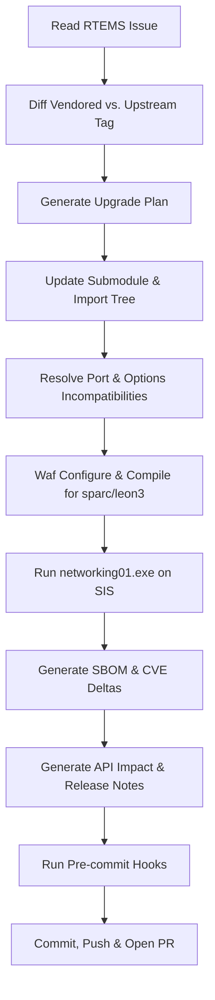

# TC2 Scenario Specification: Open-Source Component Upgrade

**Scenario ID:** TC2  
**Epic:** ANVIL-16 (Demo scenarios + QA)  
**Spike Ticket:** ANVIL-17  
**Target Repository:** `github.com/vishal7pandey/rtems-lwip` (Mirror of RTEMS lwIP integration)  
**Base Branch:** `tc2/upgrade-base-leon3` (Constructed baseline at commit `ae29242` on `vishal7pandey/rtems-lwip`)  
**Upgrade Target:** Upgrade vendored lwIP from `2.1.3` (`STABLE-2_1_3_RELEASE`) to `2.2.1` (`STABLE-2_2_1_RELEASE`)  
**Reference Upstream Solution (Withheld):** Upstream commits `a30180a462` (*lwip: Update lwIP to 2.2.1*), `0302d22c0a` (*lwip: Add missing ACD source file*), and `3543bbd989` (*lwipopts.h: Update default values for new version*)  
**Target Architecture / BSP:** SPARC / LEON3 (`sparc/leon3`) with GRETH Ethernet controller  
**Simulator Harness:** SIS (SPARC Instruction Simulator)  

---

## 1. Context and Objective

In TC2, Anvil demonstrates its ability to perform autonomous dependency maintenance and open-source library upgrades on embedded software without human developer intervention. 

Unlike TC1 (defect diagnosis and isolated code patch), TC2 exercises:
1. Upstream version tracking and release delta analysis.
2. In-tree vendored source synchronization and submodule management.
3. Embedded build system adaptation (Waf / `rtems_waf`).
4. Cross-compilation against real-time operating system headers (RTEMS 7).
5. Driver/port layer compatibility resolution.
6. Execution and verification of network tests on an instruction set simulator (SIS).
7. Automated generation of compliance and release artifacts: Software Bill of Materials (SBOM) delta, OSV vulnerability tracking (flagging known target CVEs and opening follow-ups), API impact reports, and human-readable release notes.

### Evaluation & Training Cutoff Caveat
Upstream RTEMS executed this exact upgrade in late 2025 (`a30180a462`, `0302d22c0a`, `3543bbd989`). Like TC1, evaluators can objectively compare the agent's live upgrade diff, build resolution, and configuration adjustments against this real upstream reference solution (which is strictly withheld from the agent's prompts and context).

> [!NOTE]
> **Caveat on Model Training Cutoffs:** Unlike TC1 where defects were fixed in August–October 2026 (firmly post-dating model training cutoffs), the upstream lwIP 2.2.1 upgrade occurred in late 2025, which may fall within the training data of frontier LLMs. The benchmark therefore measures autonomous orchestration and end-to-end tooling rather than pure withheld reasoning.

---

## 2. Target Selection

### Primary Target: `rtems-lwip` (Selected)
* **Repository:** `rtems-lwip` provides a standalone TCP/IP stack alternative to `rtems-libbsd`. It is self-contained, lightweight, and uses the standard RTEMS Waf build framework (`rtems_waf`).
* **Vendoring Model:** Dual tracking:
  - Submodule `lwip-upstream` pointing to `https://git.savannah.gnu.org/git/lwip.git`.
  - In-tree mirror under `lwip/`, with source and header inclusions explicitly governed by `file-import.json`.
* **Baseline State:** `STABLE-2_1_3_RELEASE` (commit `6ca936f6b588cee702c638eee75c2436e6cf75de` of upstream lwIP).
* **Constructed Baseline Branch (`tc2/upgrade-base-leon3` @ `ae29242`):**
  - Upstream snapshot `6ee76a7` (lwIP 2.1.3) only supported ARM and AArch64 BSPs, whereas the Anvil sandbox (`anvil-sandbox-rtems:7`) provides the SPARC cross-toolchain (`sparc-rtems7`).
  - SPARC/LEON3 support (`defs/bsps/sparc/leon3.json` and `rtemslwip/greth/`) was introduced upstream in commit `8e5d264`, which occurred *after* the upstream lwIP 2.2.1 upgrade.
  - To enable a realistic, self-contained SPARC upgrade scenario without modifying the upstream evaluation benchmark, `tc2/upgrade-base-leon3` was constructed on the mirror:
    * `6ee76a7` (upstream lwIP 2.1.3 base)
    * `+ 6169071` remove telnet test (test-only dependency cleanup)
    * `+ 064b35f` GCC 15 build fix for `networking01`
    * `+ 8e5d264` GRETH driver + `defs/bsps/sparc/leon3.json` (purely additive, 16 files)
    * `+` One-line GCC 15/C23 prototype fix in `leon3_greth.h` (later resolved upstream in `c5d8236`)
  - The in-tree vendored `lwip/` tree is strictly untouched (still 2.1.3). The upgrade task and upstream reference solution (`a30180a462`, `0302d22c0a`, `3543bbd989`) remain 100% authentic.
* **Target State:** `STABLE-2_2_1_RELEASE` (commit `77dcd25a72509eb83f72b033d219b1d40cd8eb95`).
* **Why this is optimal for the demo:**
  - **Bounded Execution Time:** Full clean rebuild of `rtems-lwip` with Waf takes ~2m 04s (configure 26.1s, compile 124.2s, total clean cycle 170.3s / 2.8 minutes; incremental ~10–15s) in `anvil-sandbox-rtems:7` container on a standard developer laptop, fitting comfortably within demo constraints (initial baseline measured at commit `8e5d264` / `8f3313c`, verified identical on `tc2/upgrade-base-leon3` @ `ae29242` with 102/102 objects).
  - **Deterministic Testability:** The test application `networking01.exe` runs directly under SIS in 0.28s (`rtems-test --rtems-bsp=leon3-sis` in 0.75s, 100% pass) without requiring host TAP/TUN network interfaces or root network privileges.
  - **Rich Artifact Surface:** Moves across a minor version boundary (2.1.x to 2.2.x), introducing measurable API changes (Address Conflict Detection / ACD, updated socket options) and tangible CVE posture tracking (OSV shows lwIP 2.1.3 at `6ca936f` with 0 known vulns, while 2.2.1 at `77dcd25` introduces 3 known CVEs: CVE-2026-112062, CVE-2026-119053, and CVE-2026-8836; the agent flags these and opens follow-ups rather than claiming remediation).

### Fallback Options (Evaluated & Kept in Reserve)
1. **`rtems-libbsd` Vendored Sub-component:** Upgrade a standalone utility (such as libz or mDNS) within `rtems-libbsd`.  
   *Rejected as primary:* Rebuilding `rtems-libbsd` requires 20+ minutes and significant RAM, risking timeouts on the shared demo laptop.
2. **`rtems-net-services` TFTP / FTPD:** Upgrade embedded network utility services.  
   *Rejected as primary:* The delta between releases is trivial and lacks significant CVE or SBOM impact to impress evaluators.

---

## 3. Technical Architecture & File Layout

In `rtems-lwip`, compilation is driven by `wscript` and `lwip.py`:
* `file-import.json`: Defines the upstream files copied into `lwip/` for compilation.
* `defs/common/lwip.json`: Declares common source files and include directories.
* `defs/bsps/sparc/leon3.json`: Declares SPARC/LEON3 driver sources:
  - `rtemslwip/greth/greth_netif.c`
  - `rtemslwip/greth/greth_phy.c`
  - `rtemslwip/greth/greth_mdio.c`
  - `rtemslwip/greth/greth_lwip.c`
  - `rtemslwip/greth/hw_greth.c`
  - `rtemslwip/greth/netstart.c`
* `rtemslwip/include/lwipopts.h`: RTEMS-specific tuning and feature flags.

---

## 4. Upgrade Flow for the Anvil Agent

The autonomous agent executes the following steps inside the session sandbox (`anvil-sandbox-rtems:7`):



### Detailed Steps:
1. **Inspection & Planning:**
   - Inspect baseline version in `lwip-upstream` and `lwip/src/include/lwip/init.h`.
   - Fetch upstream tag `STABLE-2_2_1_RELEASE`.
   - Identify added/removed files and configuration macro changes between 2.1.3 and 2.2.1.
2. **Source Tree Update:**
   - Advance submodule `lwip-upstream` to `STABLE-2_2_1_RELEASE`.
   - Synchronize files in `lwip/` according to `file-import.json` (including newly introduced modules such as `src/core/ipv4/acd.c` and ACD headers).
3. **Port & Build Adaptation:**
   - Update `file-import.json` if new dependencies are mandatory in 2.2.1 core.
   - Verify `rtemslwip/greth` driver compiles against new lwIP netif signatures.
   - Adjust `lwipopts.h` if upstream default macro behaviors shifted (e.g. ACD defaults).
4. **Compilation:**
   - Configure Waf using `rtems_waf` arguments (note `--rtems-tools` points to `/opt/rtems/7`, NOT `/opt/rtems/7/bin`):
     ```bash
     ./waf configure --prefix=/opt/rtems/7 --rtems-tools=/opt/rtems/7 --rtems-bsps=sparc/leon3
     ```
   - Build the network test binary (clean build ~2m 04s, incremental ~10-15s):
     ```bash
     ./waf --targets=networking01.exe -j8
     ```
5. **Simulator Verification:**
   - Run the networking test executable on the SIS simulator (completes in 0.28s; does not require external host network interfaces):
     ```bash
     sparc-rtems7-sis -leon3 -r -tlim 10 s build/sparc-rtems7-leon3/networking01.exe
     ```
     Or via `rtems-test` (completes in 0.75s):
     ```bash
     rtems-test --rtems-bsp=leon3-sis build/sparc-rtems7-leon3/networking01.exe
     ```
   - Verify output ends with expected test success markers (`*** END OF TEST NETWORKING 1 ***`).
6. **Artifact Generation:**
   - **SBOM Delta:** Generate Syft SBOM (SPDX JSON) before and after upgrade.
   - **CVE Delta & Follow-up Tracking:** Run OSV against baseline vs. upgraded tree commit. Baseline 2.1.3 has 0 known vulnerabilities in OSV; target 2.2.1 introduces 3 known vulnerabilities (CVE-2026-112062, CVE-2026-119053, CVE-2026-8836). The agent detects and flags these 3 CVEs in the target version, documenting their impact and opening follow-up remediation tasks rather than falsely claiming remediation.
   - **API Impact Notes:** Extract modified function signatures and configuration macros.
   - **Release Note:** Draft a structured release digest.

---

## 5. Required Deliverables & Acceptance Criteria

| Deliverable | Requirement | Verification Method |
|---|---|---|
| **Compilation** | Clean build with zero errors under RTEMS 7 SPARC toolchain | `./waf` exits 0 |
| **Test Execution** | `networking01.exe` executes and passes on SIS (or fallback loopback test) | Terminal log shows clean test termination |
| **Pre-commit** | Code formatting, trailing whitespace, commit message convention | `pre-commit run --all-files` exits 0 |
| **SBOM Delta** | SPDX / CycloneDX format highlighting `lwip` 2.1.3 -> 2.2.1 transition | Syft diff artifact in PR / run record |
| **CVE Delta** | Documentation of target version CVE status (flags 3 known CVEs: CVE-2026-112062, CVE-2026-119053, CVE-2026-8836) and filing of follow-ups | OSV report + follow-up tickets attached to PR |
| **API Impact Report** | Documentation of breaking changes, new features (e.g. ACD), and config options | Markdown report in PR description |
| **Confluence Page** | Release documentation published to space `RTKB` | Confluence API publication |

---

## 6. Seed RTEMS Ticket Definition

Below is the specification for the ticket to be created in the `RTEMS` Jira project (Board 139) to initiate this run.

> [!IMPORTANT]
> The `anvil` label is intentionally omitted from the ticket at creation time so the intake poller does not prematurely launch the agent before the demo. The label `anvil` is added only when the live demo is started.

* **Issue Type:** Task
* **Summary:** `[TC2] Upgrade vendored lwIP to 2.2.1 in rtems-lwip`
* **Components:** `network`, `lwip`
* **Labels:** `component-upgrade`, `tc2`
* **Description:**
  ```text
  h2. Summary
  Upgrade the vendored lwIP TCP/IP stack in rtems-lwip from version 2.1.3 to the latest stable release 2.2.1 (tag STABLE-2_2_1_RELEASE).
  Code base: branch tc2/upgrade-base-leon3 of github.com/vishal7pandey/rtems-lwip.

  h2. Scope of Work
  1. Advance the lwip-upstream submodule to tag STABLE-2_2_1_RELEASE.
  2. Synchronize the in-tree lwip/ source tree and update file-import.json as required.
  3. Resolve any build incompatibilities or configuration header changes (lwipopts.h) for RTEMS 7.
  4. Build and verify the networking stack for sparc/leon3 using Waf.
  5. Run networking01.exe under the SIS simulator (or loopback fallback) and confirm test passage.
  6. Provide an upgrade summary with SBOM delta, OSV vulnerability status (flagging target release CVEs for follow-up tracking), and API impact notes.

  h2. Acceptance Criteria
  - Waf build succeeds for sparc/leon3 without warnings treated as errors.
  - networking01.exe (or fallback loopback test) runs cleanly on SIS.
  - Pre-commit checks pass.
  - PR opened with release notes, SBOM delta, and CVE status / follow-ups attached.
  ```
