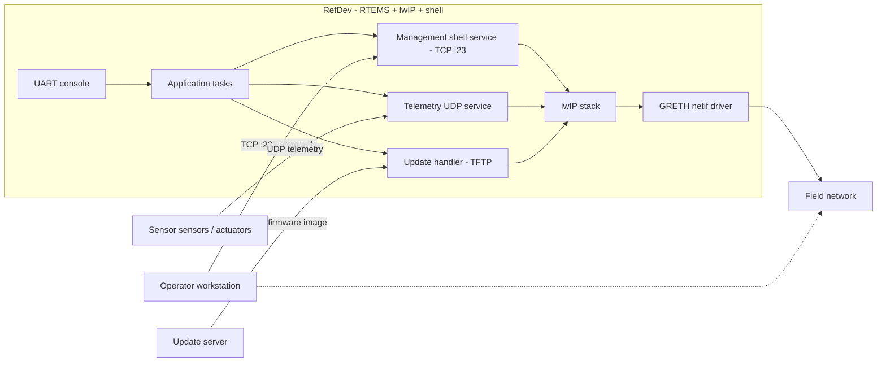

# TC3 Scenario Specification: CRA Compliance Review of a Reference RTEMS Networked Device

**Scenario ID:** TC3
**Milestone:** M3 (2026-11-08)
**Spec ticket:** ANVIL-28
**Skill consumed by:** `cra-review` (claude's skill workstream, ANVIL-20/ANVIL-21)
**Reference device repo:** `github.com/vishal7pandey/rtems` + `github.com/vishal7pandey/rtems-lwip` (mirrors)
**Regulation:** Regulation (EU) 2024/2847 — Cyber Resilience Act (CRA), Article 6 and Annex I

---

## 1. Context and Objective

TC3 demonstrates Anvil running a **structured compliance review**, not a code change. The agent
assesses a reference "product with digital elements" against the CRA Annex I essential
requirements and produces the artefacts a security engineer needs to act on gaps. No client or
product names anywhere: the reference device is a generic RTEMS-based networked device.

Unlike TC1/TC2 (fix / upgrade code), TC3 exercises:

1. A requirements checklist (`annex1.yaml`) written by us from the regulation text — the agent
   applies it, it does not invent the requirements.
2. Evidence gathering across inputs: source code, rtems-docs, an SBOM, CodeQL/Sonar findings.
3. A judgement workflow: each Annex I item is assessed `pass | gap | n/a` with cited evidence;
   gaps get a remediation plan that becomes Jira stories.
4. One or two gaps get *real* test evidence (an actual run in the sandbox), not assertions.
5. Human-in-the-loop acceptance: a security engineer accepts/rejects each gap finding;
   rejections are written back to `/memories/` so the next run calibrates.

> [!NOTE]
> The CRA applies to products "on the market". This is a demo: we review a reference device as
> if it were such a product. The checklist paraphrases Annex I; the regulation text is the
> source of truth for any real assessment.

---

## 2. Reference Device Definition

**"RefDev":** a networked RTEMS appliance image used in demos.

| Element | Definition |
|---|---|
| Hardware | SPARC/LEON3 target (as built for erc32/leon3 in the sandbox image), GRETH MAC, UART console |
| Firmware | RTEMS 7 (`vishal7pandey/rtems`, erc32 BSP), rtems-lwip TCP/IP stack (`vishal7pandey/rtems-lwip`), RTEMS shell over serial and Telnet |
| Software composition | Application tasks + RTEMS kernel + lwIP + shell + device "sensor" stubs (the parts TC2 builds) |
| Interfaces | TCP/UDP networking (management shell over Telnet :23, a status/sensor UDP service), UART debug console, optional TFTP for field updates |
| Data | Sensor readings (telemetry UDP), management commands (TCP), no stored personal data; firmware images during update |
| Failure modes | Command injection over the shell listener, unauthenticated telemetry/config changes, update-image tampering, DoS against the TCP/IP stack |

### Data-flow diagram (drives the STRIDE model)

Threat surfaces the STRIDE model names explicitly: the unauthenticated Telnet shell, the UDP
telemetry path (spoofing/tampering), the TFTP update path (tampering/repudiation), the GRETH
driver boundary (malformed frames -> kernel), and the UART console (physical access).

---

## 3. The Annex I Checklist (machine-readable: `backend/anvil/skills/cra-review/annex1.yaml`)

The checklist is `annex1.yaml`: one entry per CRA Annex I requirement, each with the
requirement paraphrased from the regulation, the citation (Annex I Part I item (1) plus items (2)(a)–(m), Part II
vulnerability-handling items, Article 6), the inputs the agent needs to assess it, and what
counts as evidence. The agent fills `status` and `evidence`; it never edits the `requirement`
or `cite` fields.

Per Annex I: products shall, **based on the risk**, (a) be made available without known
exploitable vulnerabilities; (b) have a secure-by-default configuration with user reset; (c)
support security updates, ideally automatic with opt-out; (d) protect against unauthorised
access via appropriate control mechanisms; (e) protect confidentiality of stored/transmitted
data by state-of-the-art mechanisms; (f) protect integrity of data, commands, programs,
configuration and report corruptions; (g) process only data necessary for the intended purpose;
(h) protect availability of essential functions against DoS; (i) minimise negative impact on
other devices' availability; (j) limit attack surfaces; (k) mitigate incident impact; (l)
record/monitor internal activity with user opt-out; (m) allow secure disposal/transfer of data
and settings. Part II adds: identify/document components and vulnerabilities (incl. SBOM),
remediate without delay and distribute patches, security-by-default settings documentation,
test/review of security, and coordinated vulnerability handling.

### Assessment scale

| Status | Meaning |
|---|---|
| `pass` | Requirement met; evidence cited (file:line, doc, test, scan result) |
| `gap` | Requirement not met; becomes a remediation-plan item -> Jira story |
| `n/a` | Not applicable to this device, with a one-line justification the security engineer can reject |
| `unknown` | Could not be determined from the available inputs; treated as a gap until triaged |

---

## 4. Inputs the agent uses

| Input | Where it comes from |
|---|---|
| Source code | `vishal7pandey/rtems` (erc32 BSP, shell), `vishal7pandey/rtems-lwip` (TCP/IP stack), the device service code in the scenario |
| Docs | rtems-docs (KB ingested under ANVIL-14), `docs/scenarios/tc2.md` device notes, `docs/scenarios/tc3.md` |
| SBOM | Syft SPDX/CycloneDX over the firmware build (codex's ANVIL-30 tooling where landed; the agent can also run Syft in the sandbox) |
| Code scanning | `github_code_scanning_alerts` (CodeQL on the rtems mirror PRs) |
| Static analysis | `sonar_issues` on the rtems mirror |
| Web guidance | `web_search` for CRA/clarifications (domain blocklist applies; the checklist file is authoritative) |

---

## 5. Output artefacts (priority order)

1. **Gap analysis** — every Annex I item with `status`, evidence (file:line / doc / scan result),
   and a one-paragraph justification. Gaps ranked by severity.
2. **Remediation plan** — each gap becomes a Jira story (`jira_create`, project `RTEMS`, type
   `Story`, labels `cra`, `tc3`, **never** `anvil`) with the evidence and suggested fix.
3. **Test evidence** — for 1–2 chosen gaps, an actual verification run in the sandbox (e.g. a
   listener-scan or an auth check reproduced against the built image on SIS). Real command
   output is required, recorded verbatim.
4. **STRIDE threat model** — built from the data-flow diagram above, one page, saved to RTKB.
5. **Compliance report** — the full Annex I table with statuses, the threat model link, the
   SBOM, and the remediation-story keys; Confluence page in RTKB (title
   `<KEY> evidence: CRA review of RefDev`), Jira evidence comment.
6. **SBOM** — SPDX + CycloneDX attached to the run record / PR.

---

## 6. How the security engineer accepts or rejects gaps

Each `gap` finding is presented as one approval-style decision with the evidence attached:
the engineer accepts (gap stands, its Jira story proceeds) or rejects (the finding is wrong or
the risk accepted). Rejections write a short memory entry to `/memories/cra/lessons.md` —
what was rejected and why — so the next `cra-review` run weights the same device correctly.
Accepted-but-risk-accepted gaps are still tracked as stories (marked `risk-accepted`).

---

## 7. The RTEMS demo ticket

Created: **RTEMS-3** (Task, labels `cra`, `tc3`, **no `anvil` label** — the label is added only when the live demo starts).

> **Summary:** `[TC3] CRA Annex I compliance review of reference RTEMS networked device (RefDev)`
> **Labels:** `cra`, `tc3`
> **Description:**
> Perform a Cyber Resilience Act Annex I essential-requirements review of RefDev (RTEMS 7 +
> rtems-lwip + shell, SPARC/LEON3, per docs/scenarios/tc3.md). Use the machine-readable checklist
> backend/anvil/skills/cra-review/annex1.yaml (authoritative; do not invent requirements).
> Assess each item as pass/gap/n/a/unknown with cited evidence. Produce, in order: gap analysis;
> remediation plan (one Jira Story per gap, labels cra, tc3, never anvil); sandbox test evidence
> for 1–2 gaps; a STRIDE threat model from the reference data-flow diagram; a compliance report
> page in RTKB; SPDX + CycloneDX SBOM. A security engineer approves/rejects each gap; record
> rejections to /memories/cra/lessons.md.
