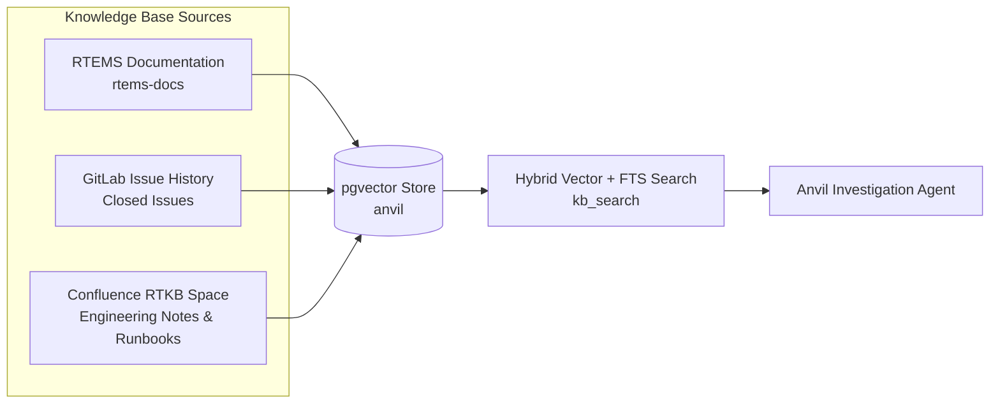
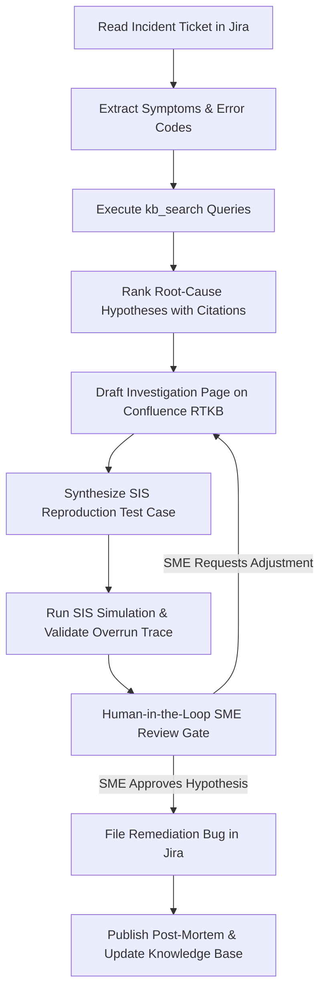

# TC4 Scenario Specification: Incident Investigation from a Knowledge Base

**Scenario ID:** TC4  
**Epic:** ANVIL-16 (Demo scenarios + QA)  
**Task Ticket:** ANVIL-31  
**Target Architecture / BSP:** SPARC / LEON3 (`sparc/leon3`) under SIS simulator  
**Knowledge Base Sources:** RTEMS Documentation, Closed RTEMS GitLab Issues, and Confluence Space `RTKB`  
**Output Artifacts:** Incident Investigation Confluence Page, Ranked Hypothesis Report, Reproduction Test Case, Remediation Jira Bug, and Knowledge Base Write-Back  

---

## 1. Context and Objective

In TC4, Anvil demonstrates autonomous **incident investigation and self-learning** in an embedded real-time environment. Unlike traditional IT services, RTEMS-based real-time systems do not have heavy application-level APM agents or alert managers. When anomalies occur (such as deadline misses, timing degradation, or communication buffer drops), engineers must deduce root causes by synthesizing runtime symptoms with deep platform knowledge, system documentation, and historical operational post-mortems.

TC4 proves that the Anvil agent can:
1. Ingest an incident report with ambiguous embedded symptoms (e.g., directive error codes, deadline overruns, telemetry packet drops).
2. Query a multimodal knowledge base (`kb_search` over `rtems-docs`, closed GitLab issues, and internal Confluence engineering runbooks).
3. Generate ranked, evidence-backed root-cause hypotheses with explicit citations.
4. Synthesize an investigation plan on Confluence (`RTKB`).
5. Reproduce the failure mechanism in the SIS simulator harness where applicable.
6. Present findings to a Human Subject Matter Expert (SME) at a deliberate decision gate to validate domain judgement.
7. File structured remediation bug reports and write back an authoritative post-mortem page to `RTKB`, demonstrating platform self-learning for future inquiries.

---

## 2. Incident Scenario: Telemetry Buffer Exhaustion & Deadline Overrun

### Operational Context
A satellite payload instrument running RTEMS 7 on a LEON3 processor acquires science telemetry through an interrupt-driven interface (e.g., SpaceWire / CAN bus / high-speed serial) and dispatches telemetry packets to a storage task via an RTEMS Classic API Message Queue (`rtems_message_queue_send`). Simultaneously, a Rate Monotonic periodic task (`TM_GUIDANCE`, 50ms period) handles attitude determination.

### Incident Trigger & Symptoms
During high-bandwidth downlink acquisition simulation, the instrument reports:
1. **Telemetry Frame Drops:** Downlink ground station observes packet sequence gaps; internal buffer counters indicate frame drops.
2. **Directive Failures:** Diagnostic logs record `rtems_message_queue_send` returning status code `RTEMS_TOO_MANY` (10) from the telemetry ISR handler.
3. **Periodic Deadline Misses:** `TM_GUIDANCE` task logs `RTEMS_TIMEOUT` (6) during `rtems_rate_monotonic_period`, reporting execution jitter exceeding 35ms.
4. **Healthy Subsystems:** Watchdog does not trip, heap memory (`malloc`) shows zero leaks, and task stack bounds checker passes cleanly.

---

## 3. Knowledge Base Corpus & Synthetic Assets

The agent investigates this incident using the unified Knowledge Base backed by PostgreSQL (`pgvector`), containing three distinct tiers of information:



### 1. Authoritative RTEMS Documentation (`rtems-docs`)
* **Message Queue Manager (`c-user/message/`):** Explains that `rtems_message_queue_send` returns `RTEMS_TOO_MANY` when all message buffers allocated at creation (`rtems_message_queue_create`) are exhausted. Crucially documents that ISRs must invoke `rtems_message_queue_send` without blocking options, meaning bursts exceeding queue capacity drop data immediately.
* **Rate Monotonic Manager (`c-user/rate-monotonic/`):** Documents period overrun mechanics, CPU budget exhaustion, and the impact of lower-priority consumer tasks starving when higher-priority ISRs saturate processing time.
* **Interrupt Manager (`c-user/interrupt/`):** Outlines ISR execution constraints, interrupt storm dynamics, and deferred service task patterns.

### 2. Historical RTEMS GitLab Issues
* Closed issues documenting buffer depletion under burst conditions and ISR preemption chains.

### 3. Seeded Internal Knowledge Pages (Confluence Space `RTKB`)
All seeded internal pages are marked with `(synthetic)` in their titles per demo hygiene rules:
* **Page 1: `[synthetic] Runbook: Real-Time Deadline Overrun & ISR Saturation Diagnostics`**
  - Outlines diagnostic workflows when `RTEMS_TOO_MANY` and Rate Monotonic period overruns coincide.
  - Specifies threshold metrics for distinguishing pure task CPU starvation from interrupt storm queue saturation.
* **Page 2: `[synthetic] Post-Mortem: 2025 Payload Bus Buffer Exhaustion Incident`**
  - Recounts a prior flight simulation incident where an unthrottled sensor interrupt burst filled the fixed message queue within 8ms, causing downstream processing backpressure and task starvation.
  - Documents the approved remediation: queue depth rightsizing combined with high-watermark backpressure signaling.
* **Page 3: `[synthetic] Architecture Note: Payload Telemetry Flow and Queue Sizing Guidelines`**
  - Defines the mathematical calculation for RTEMS message queue depths based on maximum burst duration ($T_{burst}$) and consumer drain latency ($L_{drain}$).

> [!NOTE]
> Confluence space `RTKB` already contains Devin's real page *"ANVIL-13 evidence"*. That page remains untouched. All TC4 seed pages are created under dedicated hierarchy with the `(synthetic)` prefix.

---

## 4. End-to-End Investigation Flow

The autonomous agent executes the investigation workflow according to the following stages:



### Detailed Execution Steps:
1. **Intake & Symptom Extraction:**
   - Ingest Jira ticket `RTEMS-XX` reporting telemetry drops and `RTEMS_TOO_MANY` / `RTEMS_TIMEOUT`.
   - Parse error codes to symbolic RTEMS directives (`rtems_message_queue_send` -> `RTEMS_TOO_MANY`, `rtems_rate_monotonic_period` -> `RTEMS_TIMEOUT`).
2. **Knowledge Retrieval (`kb_search`):**
   - Query: `"rtems_message_queue_send RTEMS_TOO_MANY interrupt burst"`
   - Query: `"rate monotonic period deadline overrun task starvation"`
   - Query: `"telemetry queue sizing burst duration buffer exhaustion"`
   - Retrieve top chunks across `rtems-docs` and `RTKB` synthetic runbooks.
3. **Hypothesis Formulation & Ranking:**
   - **Hypothesis 1 (Confidence: 85%, Primary):** *Interrupt Storm & Queue Sizing Mismatch.* Burst telemetry arrivals from ISR exceed the fixed message queue capacity (`RTEMS_TOO_MANY`), while excessive interrupt servicing starves the `TM_GUIDANCE` task, causing deadline misses. Supported by 2025 Post-Mortem and Queue Sizing Guidelines.
   - **Hypothesis 2 (Confidence: 10%, Secondary):** *Priority Inversion / Lock Contention.* Storage task blocking on an un-inherited mutex while holding the queue read pointer. Contradicted by symptom trace (queue read is non-blocking).
   - **Hypothesis 3 (Confidence: 5%, Tertiary):** *Memory Corruption / Leak.* Rejected based on zero heap leaks and clean stack guard checks.
4. **Confluence Investigation Document:**
   - Creates a structured page in Confluence `RTKB`: `[synthetic] Incident Analysis: Telemetry Queue Exhaustion & Rate Monotonic Overrun`.
   - Formats timeline, symptom analysis, citation links to RTEMS documentation and runbooks, and candidate hypotheses.
5. **Deterministic Reproduction in Simulator:**
   - Constructs a standalone RTEMS C test application (`tc4_reproduce.c`) in the sandbox.
   - Configures a Rate Monotonic 50ms periodic task alongside an interrupt/timer burst injecting messages into an undersized queue.
   - Executes under `sis-leon3` and confirms reproduction of:
     - `rtems_message_queue_send` returning `RTEMS_TOO_MANY`.
     - `rtems_rate_monotonic_period` logging deadline misses.
6. **Remediation Bug Creation:**
   - Files Jira defect in `RTEMS` project detailing the exact fix: increase queue buffer capacity according to the burst sizing formula and implement rate-limiting watermark callbacks in the ISR.
7. **Knowledge Capture ("Self-Learning"):**
   - Updates the knowledge base by ingesting the newly published Confluence investigation page into PostgreSQL.
   - Verifies that subsequent `kb_search` queries for these specific symptoms retrieve the new investigation report as Rank 1.

---

## 5. Human-in-the-Loop SME Review Gate

A core theme of Anvil's architecture is deliberate collaboration with human engineers. Domain judgement in mission-critical real-time systems carries high stakes.

* **Trigger:** After hypotheses are ranked and the simulation trace is captured, the agent halts and requests review via Jira comment / comms message.
* **Presented Information:**
  - Ranked hypotheses with explicit markdown citations to `RTKB` and `rtems-docs`.
  - Simulator reproduction log showing the exact directive error codes.
  - Proposed remediation strategy.
* **Human Action:** An SME reviews the analysis and transitions the Jira ticket or replies with approval (`CONFIRMED: Root cause validated. Proceed to bug filing and KB update.`).

---

## 6. Required Deliverables & Acceptance Criteria

| Deliverable | Requirement | Verification Method |
|---|---|---|
| **Incident Scenario Specification** | `docs/scenarios/tc4.md` committed and merged to `main` | Peer review and PR merge |
| **Synthetic Confluence Seed Pages** | 3 synthetic pages published to `RTKB` with `(synthetic)` titles | Confluence API inspection |
| **Knowledge Base Ingestion** | Synthetic pages ingested into pgvector DB with zero answer leaks | `kb stats` confirms chunk count increase |
| **Hypothesis Generation** | Agent produces ranked hypotheses citing both docs and runbooks | Output report includes valid URLs and chunk IDs |
| **Simulator Reproduction** | Standalone C test reproduces `RTEMS_TOO_MANY` and deadline miss on SIS | SIS execution trace exits with expected error status |
| **Jira Remediation Bug** | Detailed defect filed in `RTEMS` Jira project | Issue created with reproduction steps and sizing math |
| **Self-Learning Write-Back** | Published post-mortem indexed into KB, verifiable via `kb_search` | `kb search` returns new incident page in top 3 hits |

---

## 7. Seed RTEMS Incident Ticket Definition

Below is the specification for the ticket to be created in the `RTEMS` Jira project (Board 139) to initiate this demonstration run.

> [!IMPORTANT]
> Omit the `anvil` label at creation time so the automated intake listener does not trigger prematurely before the scheduled demo session.

* **Project:** `RTEMS` (Board 139)
* **Issue Type:** Bug
* **Summary:** `[TC4] Incident: Telemetry packet drops and TM_GUIDANCE deadline overrun under burst traffic`
* **Components:** `telemetry`, `queue`, `rate-monotonic`
* **Labels:** `incident-investigation`, `tc4`
* **Description:**
  ```text
  h2. Incident Summary
  During high-rate telemetry downlink simulation on the LEON3 payload platform, telemetry receiver logs indicate severe packet loss accompanied by real-time deadline misses on periodic guidance tasks.

  h2. Observed Symptoms
  1. Downlink receiver logs record dropped telemetry frames during 100Hz sensor burst acquisition.
  2. Telemetry ISR error counter increments with status code RTEMS_TOO_MANY (10).
  3. Task TM_GUIDANCE (priority 10, period 50ms) reports RTEMS_TIMEOUT (6) from rtems_rate_monotonic_period, indicating missed deadlines (>35ms delay).
  4. Stack monitoring and heap integrity checks report nominal status (no memory leaks or overflows).

  h2. Requested Action
  1. Query the engineering knowledge base to identify potential root causes for concurrent RTEMS_TOO_MANY and rate-monotonic deadline misses.
  2. Produce a ranked hypothesis report citing relevant RTEMS specifications and past operational runbooks.
  3. Prepare an incident analysis page on Confluence (RTKB).
  4. Reproduce the failure mode under the SIS simulator.
  5. Present findings to the lead engineer for confirmation before logging design remediation.
  ```
